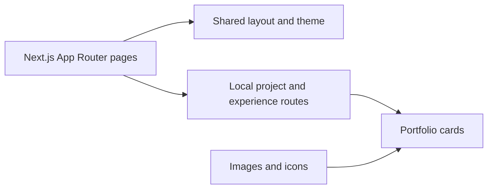

# Engineering Portfolio

**A multi-page portfolio for presenting projects, experience, skills, and publications.**

This repository contains a Next.js portfolio website. Despite the repository name `sre`, its current implementation is a personal portfolio rather than an infrastructure monitoring tool.

## Purpose

A portfolio should make it easy to move from an introduction to the work behind it. This project organizes that story into separate pages, with reusable layout components and local API routes for project and experience content.

## Included pages

| Route | Content |
| --- | --- |
| `/` | Introduction, animated text, and profile links |
| `/about` | Education and categorized skills |
| `/experience` | Experience cards fetched from a local API route |
| `/projects` | Project cards with images and links |
| `/publications` | Publication and patent-style cards |
| `/contact` | Contact information and a form interface |

## Run locally

Download and extract the repository. In the root, with Node.js and npm installed:

```bash
npm install
npm run dev
```

Open `http://localhost:3000`.

```bash
npm run build
npm start
```

## Architecture



The experience and project pages request `/api/experiences` and `/api/projects`. Other content is defined directly in page components. Framer Motion handles animation, and Tailwind CSS supplies styling.

## Customize the content

1. Update introduction and profile links in `app/page.tsx`.
2. Review the page content under `app/` and data returned by `app/api/`.
3. Replace the relevant images under `public/images/`.
4. Check navigation, mobile layouts, and external links after editing.

## Source guide

| Path | Responsibility |
| --- | --- |
| [app](app) | Pages and local API routes |
| [components](components) | Header, footer, layouts, theme, and animated text |
| [public/images](public/images) | Profile, project, and icon assets |
| [package.json](package.json) | Development and build scripts |

## Current scope

Some profile and publication URLs are placeholders and need review before reuse. The contact form should not be assumed to deliver messages without checking and connecting its submission behavior. The repository does not provide an editable content-management dashboard.

The application uses Next.js, React, TypeScript, Tailwind CSS, Framer Motion, and `next-themes`.
